# Liquid Glass for GNOME Shell


A GNOME Shell Extension that replicates the "Liquid Glass" UI concept using shaders on your desktop.

> [!NOTE]
> **Disclaimer:** This is an unofficial, community-driven fan project and is not affiliated with, endorsed by, or connected to Apple Inc. in any way.

I love the look of Apple's Liquid Glass, but since I don't own any Apple products (I use an Android smartphone and a Linux computer), I wanted a way to see it on my desktop every day. So, I decided to build it myself.

> **Are you a developer?** If you'd like to use this glass effect in your own GTK 4 / libadwaita app, take a look at [glass-lib](https://github.com/ryohsuke1231/glass-lib).

## Demo

> Unless noted otherwise, the screenshots below use the [MacTahoe GTK theme](https://github.com/vinceliuice/MacTahoe-gtk-theme) (Dark) by vinceliuice. The theme is not bundled with this extension and has to be installed separately.
>
> If you like the macOS-ish look, give MacTahoe a try. It pairs really nicely with the glass, and it's what I use every day.

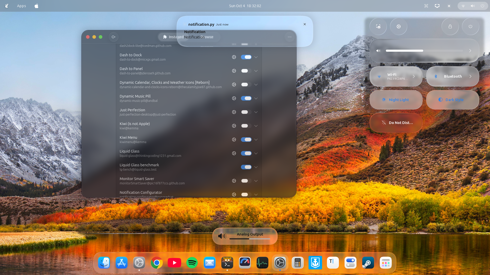

Top Bar (one pill / three pills / centered pill, off by default):

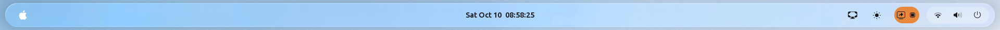

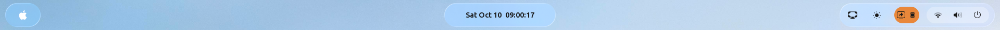

Dash to Dock:

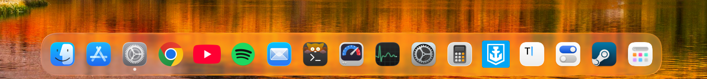

Dash to Dock with glass icons (Tinted, Light):

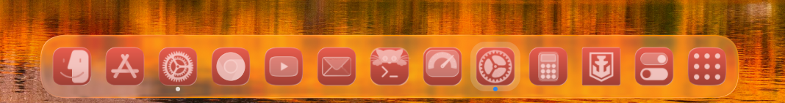

Notifications:

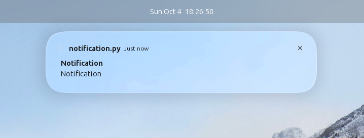

Panel Menus (right: menus growing from their button):

<p>
  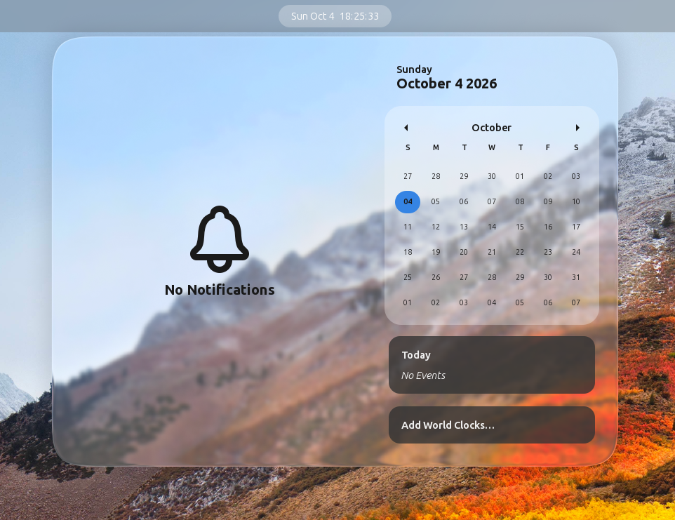
  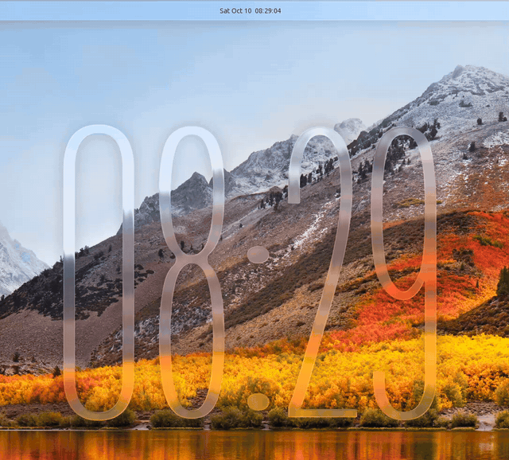
</p>

Top Bar Menu:

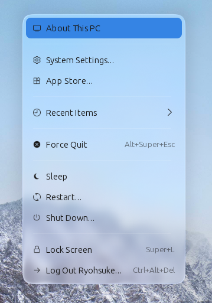

> The menu in this screenshot comes from the [Kiwi Menu](https://github.com/kem-a/kiwi-menu) extension by kem-a. Liquid Glass only provides the glass.

Desktop Menu:

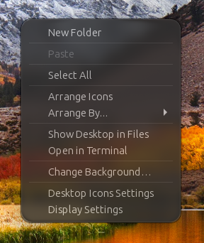

Quick Settings (Background mode, Adwaita theme):

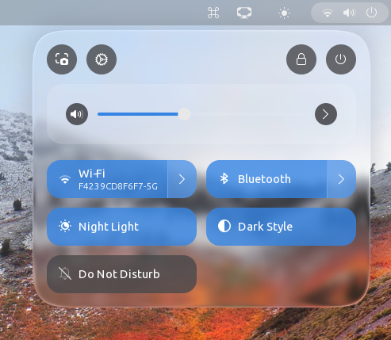

Quick Settings (Toggle mode, Adwaita theme):

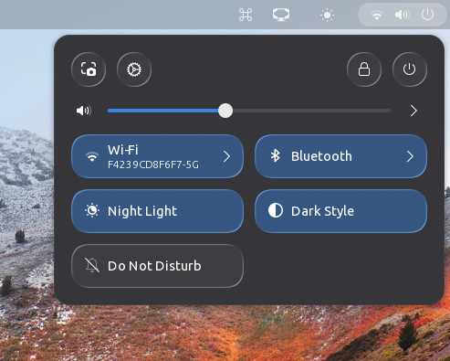

Quick Settings (Toggle mode, MacTahoe theme):

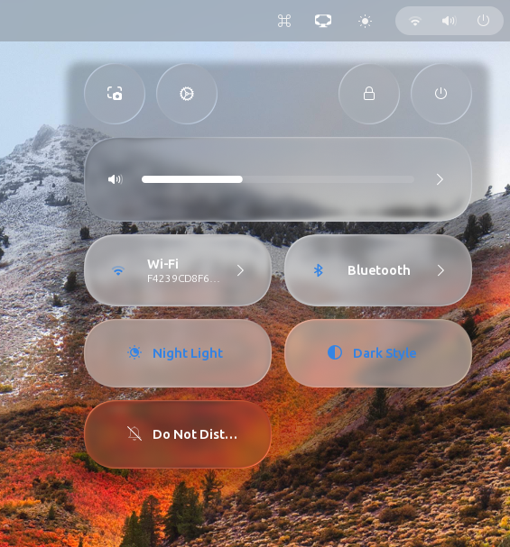

Application Windows:

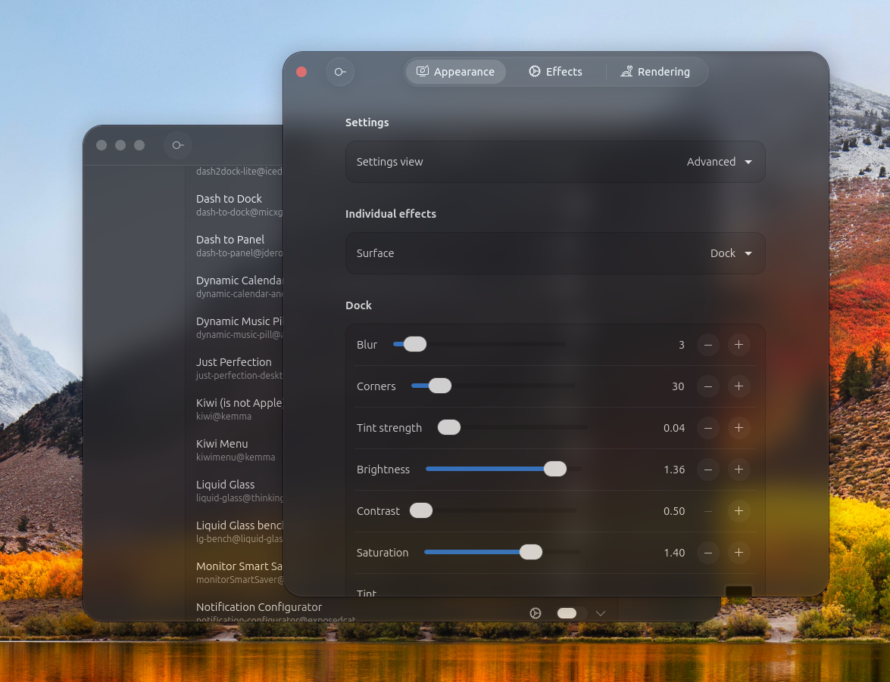

OSD:

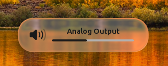

Glass Clock:

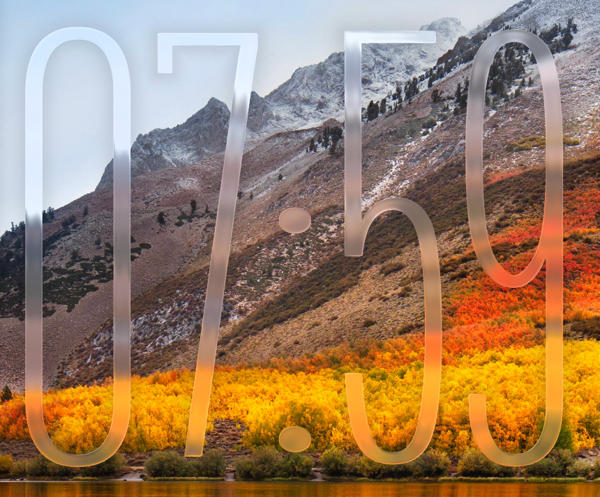

Desktop Widgets (off by default):

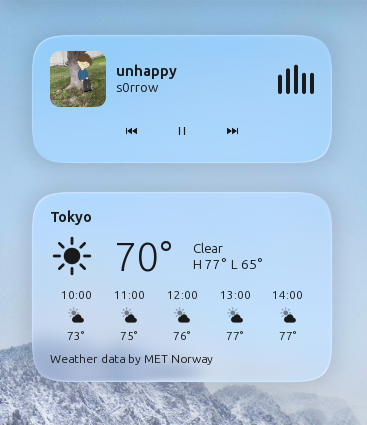


## Installation (GNOME Extension)

Liquid Glass supports **GNOME Shell 46 to 51** (for example Ubuntu 24.04 LTS, Debian 13 and current Fedora releases). It is developed and used daily on GNOME 50; the other versions are tested in containers.

> [!IMPORTANT]
> This extension is **not yet available on [extensions.gnome.org](https://extensions.gnome.org)**. It has been submitted, but is still unreviewed, so for now it has to be installed manually using one of the methods below.

### Option 1: Quick Install (Terminal)
Copy and paste this one-liner to clone and install it immediately:

```bash
git clone https://github.com/ryohsuke1231/liquid-glass.git && \
mkdir -p ~/.local/share/gnome-shell/extensions/ && \
cp -r liquid-glass/liquid-glass@thinkingcoding1231.gmail.com ~/.local/share/gnome-shell/extensions/
```

### Option 2: Manual Install
1. Clone this repository: `git clone https://github.com/ryohsuke1231/liquid-glass.git`
2. Open the `liquid-glass` folder.
3. Copy the **entire `liquid-glass@thinkingcoding1231.gmail.com` folder** to:
   `~/.local/share/gnome-shell/extensions/`
4. **Restart GNOME Shell**:
   - **Wayland**: Log out and log back in.
   - **X11**: Press `Alt` + `F2`, type `r`, and hit `Enter`.
5. Enable **Liquid Glass** in the "Extensions" app or Extension Manager.


## What Can Be Made of Glass

The effect can be enabled or disabled per UI element on the **Effects** page. In the **Simple** view every element shares one look (blur, corners, tint, outline); switch the view to **Advanced** (Appearance → Settings) to tune each element on its own — tint color and strength, an **outline** (a line along the visible edge of the glass, shadow not included, to make it easier to see: switch, width and color; the glass clock has none), blur radius, corner radius, glass expand, offsets, and brightness / contrast / saturation — plus the element-specific features listed below. Values you tune by eye have a slider next to the number; values whose number is what matters (spring constants, intervals) are typed in. Settings that depend on a switch (the outline, animations, adaptive color) sit indented below it and fold away with the arrow at the end of the switch's row.

| Element | Notes / Special features |
| --- | --- |
| **Top Bar** | The bar itself, as **one pill** across the screen, **three pills** behind its groups of buttons (activities, clock, status icons), or a **centered pill**: the bar shrinks to its buttons and sits in the middle of the screen, like a dock at the top, with Quick Settings opening centered under its button. The centered pill keeps the clock group in the middle, so when one side has more buttons than the other it leaves room on the shorter side. Chosen on the Effects page (Appearance → Top bar in the Advanced view). The space around the pills (**margin**) and between their edges and the buttons (**padding**) can be set per side in the Advanced view; the bar grows to make room, and maximized windows stay below it. The top bars that other extensions add on further monitors, such as [Multi Monitors Bar](https://github.com/FrederykAbryan/multi-monitors-bar_fapv2)'s, get the same glass with the same settings, unless they run along a side of the screen. Off by default. Supports **adaptive text coloring**. |
| **Dock** | Glass behind the dock of the Dash to Dock / Ubuntu Dock extension or of [Dhruva](https://github.com/narkagni/dhruva). With Dash to Dock, a bottom margin control lets the dock float above the screen edge; Dhruva keeps its own margin setting. The glass follows Dhruva's dock as it widens under the pointer while the icons are magnified. |
| **Application Icons** | The icons in Dash to Dock (the Show Apps button too) or Dhruva, in the launcher's results and in the overview's app grid, redrawn as glass plates under a one-color symbol, as in macOS 26 and iOS 26. See [Glass Icons](#glass-icons). Off by default. |
| **Calendar & Other Top Bar Menus** | Glass behind the calendar (clock) menu and behind the menus of the other top bar indicators — the keyboard layout and accessibility menus, and the indicators other extensions add, including [ArcMenu](https://gitlab.com/arcmenu/ArcMenu)'s menu and its right-click menu. The calendar menus of the top bars other extensions add on further monitors, such as [Multi Monitors Bar](https://github.com/FrederykAbryan/multi-monitors-bar_fapv2)'s, get the same glass and follow the calendar menu's settings. The calendar menu's cards (messages, events, world clocks) follow the colour scheme in GNOME Settings: dark under Dark, pale under Default, with the text colours set to match. Each detected menu can be switched off on its own. Menus **grow out of their button**, after [liquid-dom](https://github.com/AndrewPrifer/liquid-dom)'s menu demo: the button's highlight drops out of the button and rounds off into a drop of glass, which is thrown out to where the menu will be — each time with a small push in a random downward direction — and swells into the menu, its items coming up through the glass, seen bent by its rim at first. Closing runs it back: the menu shrinks into a drop that rises into the button, widening into its highlight on the way, and fades once it has become the highlight. On by default (Appearance → Behavior → "Menus grow from their button"). With that off, a **custom spring animation** (stiffness / damping / mass) scales the menu instead. Also supports **adaptive text coloring**. |
| **Notifications** | Glass behind notification banners. Supports **adaptive text coloring** and a hide safety margin to avoid flicker while the banner is dismissed. |
| **Quick Settings** | Two modes: **Whole menu** applies one sheet of glass behind the whole panel, and **Individual buttons** turns every toggle button into its own piece of glass, keeping each toggle's own accent color (see "Button base color"). Also supports spring animation and adaptive text coloring; in Individual buttons mode the buttons can spring out of the middle of the menu as it opens, those nearest the panel button fastest. |
| **OSD** | Glass behind the on-screen displays (volume, brightness, and so on), with adaptive text coloring. |
| **Application Windows** | Glass behind application windows, with a **window content opacity** slider so the glass shows through the window itself. Applies either to selected applications, or to all windows minus exclusions. Both lists are filled from a live picker of your currently open windows, so there is no need to look up `WM_CLASS` values by hand. |

### Glass Icons

No icon is redrawn by hand: each one is taken apart once, in a process of its own, into the plates it is drawn on (rounded squares, circles, squircles, diamonds and other smooth shapes, a gear's regular teeth included, outermost first) and the symbol on them. After macOS 26's tinted, white and clear icons, the outer plate becomes a piece of glass, the plates on it take the icon color, lighter or darker as they (or parts of them) were lighter or darker than what is beside them, and the symbol is drawn over them in a color that stands apart from the plate under it, its parts in different colors at different strengths (red and green of one lightness too). What is symbol is decided for each colored area as a whole, so that gradients, soft shadows and glows stay part of the plate they are on, a gloss over the symbol stays part of the symbol, a faint veil of white or black over a gradient stays part of the plate, and a symbol keeps its gradients and the fade it has over a hole in its plate. A rim the icon draws along its own outline gives way to the glass's rim. Alike shapes side by side become plates together, even when they are a little too small for one on its own, and a surface cut into pieces of three or more colors (a pie, a puzzle) is drawn as symbol, none of its pieces taken for the plate's own color, along with the ring or disc in its middle. An icon that is not drawn on a rounded square is set on a squircle, an icon's own rounded square gets corners that meet its sides smoothly (a little, so that it still fits what is on it), and every outer plate is brought to one size, so that all icons share the same outline; a plate that carries a picture, such as a photo or pixel art, is drawn as symbol in shades that keep its colors apart, on glass. The results are kept in the user's cache, so an icon is only taken apart again when it changes. Icons are taken apart by a few processes side by side, and a few seconds after the extension starts, those of every installed application that will be redrawn are taken apart ahead of time, so that opening the app grid does not wait for them; a notification says when this starts and when it is done. While an application starts, the icon that zooms out of the dock keeps its picture, in the icon color.

- **Look** — **Tinted**, **Mono** (dark glass in white and grey) or **Clear** (each plate is real glass that refracts and lights what is behind it the way the rest of the glass does, with the same settings: the dock's or the launcher's glass, the app grid's background, and the plates under it; hardly frosted, with a rim a little wider than the glass's, under a white symbol with a soft shadow). The clear glass follows what is behind it as it changes, and is read once for all the icons of a dock, app grid, folder or launcher, so that scrolling the app grid or hiding the dock stays smooth. With Clear picked, the preferences offer to darken the dock (a black tint at 0.16 strength), which keeps the icons readable on a light wallpaper. Tinted comes in two variants: **Dark** (dark opaque glass, with the plates on it and the symbol in the icon color) and **Light** (glass in the icon color, a little darkened, under an almost white symbol).
- **Color** and **Tint strength** (Tinted only) — the system accent color (GNOME 47 and later) or a color of your own, and how much of it the dark variant's glass takes as well (none by default).
- **Dock**, **Launcher** and **App grid** — where icons are redrawn, each on its own (the app grid's folders included, as well as the small icons on a folder's own icon). **Dock** covers Dash to Dock and Dhruva alike; Dhruva's folders, trash and other items that are not applications keep their own icons.
- **Size** — the icons' size as a share of what the dock, the launcher or the app grid gives them, for icons that look small on the dock without changing Dash to Dock's own icon size.
- **Symbol opacity**.
- **Glass tuning** — a small window of sliders for the finer numbers of the current look (the glass's lightness and opacity, how much white or color the plates and the symbol take, the rim and the sheen; Clear takes its rim and refraction from the glass settings and sets how much wider its rim is), with a button that puts every look back to its defaults.
- Every application's icon, minus the ones you leave out, or only the ones you pick, each list filled from a picker of the installed applications.

### Adaptive Text Coloring

Where it is supported, the extension samples the brightness of what is behind the UI and adjusts the text color so labels stay readable on both bright and dark wallpapers. A **Preferred text color** (Automatic / Light / Dark) decides the cases where the background favors neither. The sample interval is configurable; a shorter interval reacts faster but costs more CPU.

### Quick Settings: Whole menu vs. Individual buttons

Chosen with **Apply quick settings glass to** under **Effects → Show glass on**, or with **Apply glass to** in the quick settings surface of the advanced **Appearance** page.

- **Whole menu** applies the glass as one continuous sheet behind the whole quick settings panel. Corner radius, X/Y offset and the spring animation apply to that sheet.
- **Individual buttons** gives each toggle button its own glass shape, tracked individually. With **Animations** on (the switch the quick settings surface of the advanced **Appearance** page shows in this mode, also set by Behavior → Animations), the menu opens with every button's glass already there, gathered towards the middle of the menu and at 70% of its size; the buttons then all spring out to their places at once — those nearest the panel button fastest — swinging once a little past their size, and their labels and icons fade in as they go. The glass of two buttons is never let closer than 3 px (or than at rest). The menu closes with the shell's own fade. "Button corners" sets the roundness of each shape, and "Button base color" controls how much of the toggle's own original color (for example the blue of an active toggle) is kept, independently of the custom tint color. The menu keeps the theme's own background behind the buttons, so this mode is meant for themes whose quick settings menu is transparent, such as [MacTahoe](https://github.com/vinceliuice/MacTahoe-gtk-theme) (Dark). On a theme with an opaque menu (most light themes) the buttons have nothing to refract and look flat; use **Whole menu** there. The sliders and the header are not touched.


### Using it with Blur my Shell

Recent versions of [Blur my Shell](https://github.com/aunetx/blur-my-shell) (74) blur popup menus, notifications and OSDs by default. Its blur shows through the glass, so turn off **Popups** in Blur my Shell; while it blurs popups that have glass, the extension notes it in its log when Logging is on. Turning off Popups leaves Blur my Shell's other effects on. While Blur my Shell blurs the top bar, the dock or application windows where Liquid Glass draws glass, the Liquid Glass preferences show a warning at the top of the Appearance page with a button that goes to the override below.

Or let Liquid Glass do it: **Override Blur my Shell** (Rendering → Compatibility, shown while Blur my Shell is installed) turns Blur my Shell's blur off for the parts that also have glass, for as long as Liquid Glass runs. The parts are chosen below the switch: **menus and popups** (Blur my Shell blurs dialogs and switchers with the same setting), **top bar**, **dock** (on by default) and **application windows** (off by default, as it turns off all of Blur my Shell's window blur). A part gets its blur back when it loses its glass, when the override is turned off and when Liquid Glass is turned off (not when the screen locks). Blur my Shell's own settings are what change, so its preferences show them off meanwhile; turning one back on there while it is overridden is undone.

## On the Desktop

The **Desktop** page of the preferences adds glass that is not part of GNOME's own interface. All three are off by default.

### Glass Clock

A large clock whose digits are themselves glass, like the clock on the iPhone's lock screen, with the date above it. It sits on the desktop below the windows. Pick a place for it (one of the four corners or the center) in the preferences or from its right-click menu (**Position**), or right-click it and choose **Move and Resize**: a frame appears round it, to drag it anywhere and to resize it by the handles. The side handles make the digits wider; the top and bottom ones make them taller the way the iPhone's tall clock does, in one of two ways (**Taller digits** in the preferences): **evenly** or **along their upright strokes** (the default), lengthening the straight upright parts while curves and bars keep their shape and the parts above and below a join in the middle (of a 3, 5 or 8) grow alike. Either way every stroke keeps its width whichever way it runs, corners stay sharp and the colon's dots keep their shape; the corners scale the whole clock. It stays where it was moved until you pick a place again. The font, the size, the width, the height, the time format (as in Settings, 24-hour or 12-hour), the date, the blur and the tint can be changed. Four condensed fonts that suit a tall clock come with the extension, each in Light, Regular, SemiBold and Bold: [Antonio](https://fonts.google.com/specimen/Antonio), [Barlow Condensed](https://fonts.google.com/specimen/Barlow+Condensed), [Saira Extra Condensed](https://fonts.google.com/specimen/Saira+Extra+Condensed) and [Sofia Sans Extra Condensed](https://fonts.google.com/specimen/Sofia+Sans+Extra+Condensed), all under the SIL Open Font License (`fonts/`); Barlow Condensed Light is the default. The interface font or any installed font can be picked instead.

### Desktop Widgets

Cards of glass on the desktop, stacked in a corner or the center of the primary monitor. Right-click one to put it in another corner on its own (**Position**), or choose **Move** to put it anywhere else:

- **Weather** — the current weather and the next hours, for a city or town searched for in the preferences, down to small towns that GNOME Weather has no location for; without one, for the location set in [GNOME Weather](https://apps.gnome.org/Weather/), as the calendar menu shows it. With GNOME Weather installed the forecast comes from libgweather (MET Norway), as in GNOME Weather; without it, from [Open-Meteo](https://open-meteo.com/). The card names its source. Click the card to open GNOME Weather.
- **Up next** — the rest of today's events and tomorrow's, from the calendars the calendar menu shows. Click it to open GNOME Calendar.
- **Now playing** — the track a music or video player is playing (any MPRIS player), with its cover art, previous, play/pause and next buttons, and five bars beside the title that follow the sound being played (an FFT of the default output, through GStreamer). GNOME shows its microphone indicator while the bars listen; they can be switched off in the preferences (**Sound bars**). Hidden while no player is running.

Widgets that were moved one above the other stay a stack: when one grows, shrinks or is hidden (Now playing while no player runs), the ones below it follow instead of overlapping it or leaving a gap.

While one is moved, dotted guides show where it lines up with the others and the clock (the same edge, or the same center line), with the middle of the screen, and where it sits as far from one item as that item is from the next; near such a place it snaps onto it. Their text takes the light or dark color set as preferred in the preferences for as long as that stays readable on the wallpaper behind it, so it does not keep flipping on a busy background.

The widgets and the clock are hidden in the overview, together with the windows. With desktop icons ([Desktop Icons NG](https://gitlab.com/rastersoft/desktop-icons-ng)) they sit above the icons, so they can be clicked.

Their right-click menu just appears; under **Appearance → Desktop widgets** it can instead grow out of a drop of glass where you clicked, or open on a spring.

### Launcher

A search field on glass in the middle of the screen, like Spotlight, opened with <kbd>Super</kbd> + <kbd>Alt</kbd> + <kbd>Space</kbd> (changeable in the preferences). It asks the same search providers as the overview, so it finds applications, settings, files, calculations and whatever else your installed apps provide, as far as they are enabled in Settings → Search. Use the arrow keys and <kbd>Enter</kbd>, or click a result; <kbd>Esc</kbd> or a click outside closes it.

The width of the search field, the height of the pinned items' page and the size of its icons can be set under **Desktop → Launcher**; on a small screen, for example a laptop at 200 % scaling, a narrower launcher keeps clear of the desktop widgets. The results scroll when they would run off the bottom of the screen.

Applications that GNOME Software finds but that are not installed yet are marked **Install**; <kbd>Enter</kbd> opens them in GNOME Software.

Arithmetic such as `3*8`, `3*8=` or `1-5` is worked out by the launcher itself and shown first; <kbd>Enter</kbd> copies the result.

Point at a result and a pin appears on its left: click it to pin the result (applications, files, settings and the like; not calculations). Pinned results keep a filled pin, come first when they match a search, and are listed on their own page, opened with <kbd>Ctrl</kbd> + <kbd>P</kbd>: applications in a grid (as many columns as the launcher's width and the icon size allow, the tiles spread evenly over the row), everything else in a list below, each with its pin to unpin it. The back button, <kbd>Esc</kbd> or <kbd>Ctrl</kbd> + <kbd>P</kbd> goes back to the search, as does typing. The glass changes to the larger page either by morphing, with the content seen deep in the glass on the way, or by easing with the content fading (**Desktop → Launcher → Change to pinned items**).

## Preferences

- **Appearance** — shared blur, corners, tint and outline; animations, adaptive color and matching menu heights; **Backup**, which exports every setting to a file and imports it again.
- **Effects** — choose where glass appears: top bar, dock, menus, popups (and whether quick settings get one sheet or one per button), application icons and application windows. The advanced view lists every surface on its own here, the top bar included.
- **Desktop** — the glass clock (whether it shows, the time format and the date), the desktop widgets and the launcher (its shortcut). The clock's place, size, font and glass (blur, tint color and strength, brightness, contrast, saturation), and the launcher's width, the height of the pinned items, their icon size and how it changes to them, are surfaces of the advanced **Appearance** page.
- **Rendering** — rendering quality, refraction, edge lighting, shadows and diagnostics.

Opening the window preserves your configuration. **Custom** means your existing
values differ or do not match a preset. Editing a shared control applies its value
to every surface; it does not enable disabled effects. Menu animations default to
**Smooth**, which does not bounce. See [Preferences](docs/preferences.md) for behavior and tests.


## Glass Settings (Rendering page)

The **Rendering** page controls the shader itself. These settings are global and apply to every element above at once. The Simple view shows the main ones; the Advanced view shows all of them.

### Blur
- **Method** - `Gaussian` (most accurate) or `Dual Kawase` (cheaper; the radius is not pixel-accurate). The Simple view's **Quality** preset picks the method and the resolution together.
- **Resolution** - `Half` or `Quarter`. Quarter blurs a quarter of the pixels, at the cost of a visibly coarser blur.

### Optics
- **Thickness** - The simulated physical thickness of the glass. Higher values bend the background more strongly near the edges.
- **Refraction** - The overall strength of the refraction distortion.
- **Edge smoothing** - Feathering width of the glass silhouette, used as geometry anti-aliasing.
- **Surface curvature** - The superellipse exponent describing the cross-section of the glass. Low values give a soft, dome-like surface; high values give a flat top with a sharp roll-off at the edge.
- **Index of refraction** - Optical density of the material. Real glass is roughly 1.5 to 2.4.
- **Color separation** - RGB separation (chromatic aberration) in the refracted image, as a fraction of the refraction: the colors part only where the glass bends the background, and most where it bends it most. `0` by default: macOS's glass shows none.
- **Corner smoothing** - Continuous (squircle-like) corners, as on macOS and iOS. `0` gives circular arcs; higher values start the curve earlier, up to (1 + value) times the corner radius from the corner, so it meets the straight edges without a visible crease. The corner's midpoint stays where the circular one would be, so the corner radius keeps its meaning. Corners with no room to grow, such as pill-shaped buttons, stay circular, and application windows always keep circular corners to match the window. `0.6` by default.

The lens acts over a fixed band (22 px) along the edge, whatever the corner radius or the size of the element, as measured on macOS; the settings above shape the lens inside that band. An element thinner than the band gets the same lens scaled down.

### Lighting
- **Highlights** / **Shininess** - Brightness and sharpness of the specular highlights.
- **Edge light width** / **Edge light** - Size and brightness of the light band along the edges.
- **Edge directionality** - How strongly the virtual light direction shapes the edge light (higher values concentrate it on the lit side).
- **Edge falloff** - Falloff of the Fresnel term for the edge light.
- **Edge color strength** - Multiplier for the edge light color.
- **Sheen** - A broad sheen spread across the surface, sampled from the background. `0` by default.
- **Light angle** - Direction of the virtual light source, in degrees.
- **Color from backdrop** - The edge light, highlights and sheen take the color of what is behind the glass instead of plain white, at the same brightness. On by default.

### Shadows
The drop shadow anchors the glass on light backgrounds (a white wallpaper, for example) so it does not visually disappear.
- **Shadow radius** - How far the shadow extends past the glass edge. `0` disables it.
- **Shadow strength** - How dark the shadow is.

A separate ambient-occlusion style darkening sits just inside the glass edge, independent of the outer drop shadow.
- **Inner shading** - How dark the inner band gets. With the edge light on, the darkening falls only where the edge light does not (the edges that run along the light direction), as on macOS.
- **Inner shading radius** - How far inward the darkening extends before fading out.

### Compatibility
- **Override Blur my Shell** - Shown while Blur my Shell is installed. Turns its blur off where there is glass; see [Using it with Blur my Shell](#using-it-with-blur-my-shell).

### Troubleshooting
- **Logging** - Print the extension's logs to the journal / terminal. Useful when reporting a bug.
- **Render diagnostics** - More detailed rendering state in the logs; adds overhead, so leave it off for normal use.
- **Dump shortcut** - A global shortcut (Ctrl+Alt+L unless changed in the row under the switch) that records the glass state for a bug report.


## The WebGL/Three.js Prototype (The Lab)

Before writing the GNOME implementation in GJS/Clutter, I built a standalone WebGL prototype using Three.js to perfect the math, shaders, and real-time tuning.

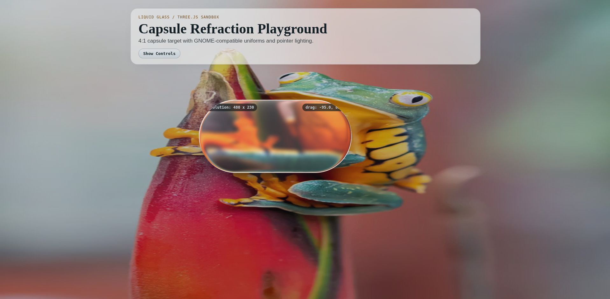

You can run the web prototype locally:
```bash
cd prototypes/sandbox-threejs
npm install
npm run dev
```


## Development & AI Usage

This project is written in TypeScript and compiled to GJS. To build it:

```bash
cd liquid-glass@thinkingcoding1231.gmail.com
npm install
npm run build
```

The [source layout and test instructions](docs/architecture.md) describe module ownership and renderer lifecycle constraints.

A significant part of this codebase was written with the help of AI coding assistants, primarily **Claude (Anthropic)**, used for implementation, shader debugging, and refactoring. The design, the shader math, the architecture decisions, and all of the testing on real hardware are mine, and every change is reviewed before it lands.


## Roadmap

### Done
- [x] Perfect the WebGL/Three.js Prototype
- [x] Port GLSL shaders to GNOME Shell
- [x] Apply Liquid Glass to Top Panel Menus
- [x] Extend glass to more panel menus (keyboard layout, Vitals, desktop right-click menu)
- [x] Add Dash to Dock support
- [x] Add Notifications support
- [x] Add Settings Feature
- [x] Add Simple and Advanced preference views
- [x] Add Adaptive Text Coloring
- [x] Add Quick Settings support (Background mode)
- [x] Add Quick Settings Toggle mode (per-toggle glass)
- [x] Add OSD support
- [x] Add Application Window support (originally by [@hoshizora-chi](https://github.com/hoshizora-chi))
- [x] Add window blacklist with a visual window picker
- [x] Match the lens and edge to macOS 27
- [x] Improve performance (blur reuse, region-limited blur, reading the backdrop from the stage)
- [x] Support GNOME 51
- [x] Support GNOME 46, 47, 48 and 49
- [x] Continuous corners, refraction-proportional color separation and backdrop-colored highlights
- [x] Add ArcMenu support
- [x] Add top bar glass (one pill or three pills)
- [x] Grow menus out of their top bar button
- [x] Add a glass clock, desktop widgets (weather, up next, now playing) and a search launcher
- [x] Move and resize the clock and the widgets from their right-click menu
- [x] Tall clock digits that grow along their upright strokes, with smoother glass on glyph corners and curves
- [x] Ship four condensed clock fonts, and give every desktop item a Position menu
- [x] Menus that grow out of their button as in liquid-dom, with their items seen through the glass; tall clock digits that keep their stroke width
- [x] Sound bars on the Now playing widget; menus that grow as one drop of glass; tall clock digits that grow evenly
- [x] Choose how the clock's digits grow taller (evenly or along their upright strokes), and make them in a process of their own so the shell never stalls for them
- [x] Snapping guides for moving the clock and the widgets
- [x] Glass application icons in the dock and the launcher (tinted, mono, clear)
- [x] Glass application icons in the app grid
- [x] Pin launcher results, with a page of pinned items, and work out arithmetic in the launcher
- [x] Export and import the settings, set the launcher's size and its pinned icons' size, scroll its results, mark applications that are not installed, and keep desktop widgets in a stack when their content changes
- [x] Outline for the glass of each element, and settings that fold away under their switch in the advanced preferences
- [x] Add Dhruva dock support, an opening animation for Quick Settings' Individual buttons mode, and an override for Blur my Shell's blur where there is glass
- [x] Centered top bar pill that shrinks the bar to its buttons

### Next
- [ ] Publish to extensions.gnome.org
- [ ] glass-lib: a glass library for apps

## License

MIT. See [LICENSE](LICENSE).
